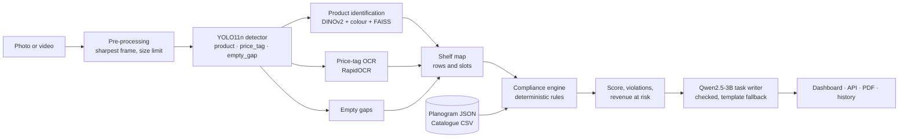
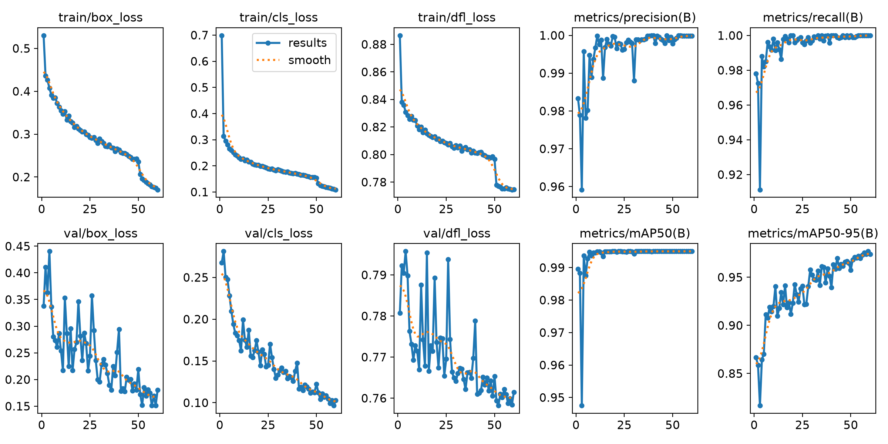

# ShelfSense AI

**Autonomous retail compliance agent: one shelf photo in, a scored audit out.**

ShelfSense audits a supermarket shelf from a single photo or a short video. It
finds every product, price tag and empty gap, identifies each product against
the store catalogue, reads every price, compares the result with the planogram
(the plan of how the shelf should look) and the price list, and produces a
0–100 compliance score, the exact violations with their locations, the revenue
at risk, and a ranked task list for store staff. Everything runs offline on a
CPU, inside a container sized like a small edge device (4 vCPU / 8 GB).

Built for Confluentia 2026 · Tredence Hackathon · Problem Statement 1.

| At a glance | |
|---|---|
| Audit time per shelf photo | **1.85 s** on 4 vCPU / 8 GB, no internet, no GPU |
| Product detection (mAP@0.5) | **0.995** (target ≥ 0.85) |
| Product identification | **98.1%** top-1 (target ≥ 90%) |
| Price reading | **97.4%** exact (target ≥ 90%) |
| Empty-gap recall | **99.5%** (target ≥ 90%) |
| Violations found, photo to audit | **94.8%** precision, **94.3%** recall |
| Peak memory incl. language model | **4.2 GB** |
| Evaluation data | 500 synthetic test shelves with answer keys (see [Data](#data)) |

---

## Contents

1. [The problem](#the-problem)
2. [What ShelfSense does](#what-shelfsense-does)
3. [Try it](#try-it-one-command-no-setup)
4. [How it works](#how-it-works)
5. [Data](#data)
6. [Models](#models)
7. [Compliance logic](#compliance-logic)
8. [Results](#results)
9. [Edge deployment and performance](#edge-deployment-and-performance)
10. [Dashboard, API and reports](#dashboard-api-and-reports)
11. [Design decisions](#design-decisions)
12. [Limitations](#limitations)
13. [Roadmap](#roadmap)
14. [Reproduce everything](#reproduce-everything)
15. [Project layout](#project-layout)
16. [Licences](#licences)
17. [Sources](#sources)

---

## The problem

Shelves change all day as customers shop and staff restock, but shelf checks
are still mostly a clerk walking the aisles with a checklist: slow,
subjective, infrequent, and hard to scale across stores.

| Issue | What happens on the shelf | Business impact |
|---|---|---|
| Stock-outs | Empty facings, unfilled gaps | Lost sales; shoppers switch brand or store |
| Planogram drift | Product in the wrong row or order, too few facings | Brands pay for placement they don't get; customers can't find items |
| Price / label errors | Tag shows the wrong price or sits under the wrong product | Margin leakage, overcharge complaints, regulatory risk |
| Manual audits | Checklist walk-throughs | Slow, subjective, infrequent |

Retail out-of-stock research (e.g. the Gruen, Corsten & Bharadwaj global study)
is widely cited as finding about **8% of items out of stock** at any moment,
with roughly **1 in 3 shoppers** buying the item elsewhere when they meet a
stock-out. These are approximate industry figures that illustrate scale; they
are not ShelfSense measurements.

## What ShelfSense does

Three checks run on every planned slot of the shelf:

| Module | Checks | Violations it reports |
|---|---|---|
| **A · Planogram compliance** | Is the right product in each slot, in the right order? | Misplaced product (with its correct row and position), extra / unknown / unplanned product |
| **B · Price and label verification** | Does each tag belong to the product above it, at the catalogue price? | Wrong price, wrong label, missing tag |
| **C · Shelf availability** | Are all planned facings filled? | Out of stock, low stock (with units to replenish) |

Each audit produces:

- an **annotated shelf image**: every slot outlined green (compliant), amber
  (low stock), red (violation) or purple (needs a human check);
- a **compliance score** 0–100 with a band (Good / Needs attention / Critical);
- the **violations**, each with row, position, expected vs found, and revenue at risk;
- a **ranked task list** for staff and a one-line summary for the manager,
  worded by a small language model and checked against the audit;
- a one-page **PDF report** and a **score history** per shelf.

Inputs can be a **photo or a short video**; for a video, the sharpest frame is
audited automatically.

## Try it (one command, no setup)

The whole app (dashboard, API, vision models and Qwen2.5-3B) is published as
one Docker image: [ashishsingh5042/shelfsense](https://hub.docker.com/r/ashishsingh5042/shelfsense)
(tags `latest`, `1.0`). No GPU, no Python, no training.

**You need:** [Docker Desktop](https://www.docker.com/products/docker-desktop/),
about 8 GB of RAM and 12 GB of free disk, on a 64-bit Intel/AMD machine
(Windows, Linux or an Intel Mac).

1. Install Docker Desktop and start it. On Windows, accept enabling WSL 2 if
   asked. Wait until it shows **Engine running**.
2. Open a terminal and run:
   ```
   docker run -d --name shelfsense --cpus 4 --memory 8g -p 8501:8501 -p 8000:8000 -v shelfsense-data:/data ashishsingh5042/shelfsense:latest
   ```
   The first run downloads about 3 GB.
3. Wait about 30 seconds, then open:
   - **Dashboard:** http://localhost:8501. Pick a sample shelf in the
     sidebar and press *Run audit*. Try the hand-held video sample too.
   - **API docs:** http://localhost:8000/docs
4. Stop it with `docker stop shelfsense`, start it again with
   `docker start shelfsense`, remove it with `docker rm -f shelfsense`.

Everything runs offline inside the container; the internet is only used to
download the image. The language model takes about 20 seconds longer than the
rest to load; until it is ready, task lists use the template wording.

**Training and test datasets, images and results** for this model (trained on
synthetic shelves): [Google Drive](https://drive.google.com/file/d/16za4mJgrRiE2nwPLGf2weDbwYfbIenTE/view?usp=drivesdk).

## How it works

Perception and reasoning are deliberately separated. Neural models only
*see* (boxes, product identities, tag text). Every compliance decision is made
by transparent rules, so every flag can be explained and traced to one slot on
one shelf. A small language model only *words* the result.



| Stage | What happens | Code |
|---|---|---|
| Pre-processing | EXIF rotation, size limit (4,000 px), sharpest frame of a video by Laplacian variance, blur warning | `perception/preprocess.py` |
| Detection | YOLO11n (ONNX) finds products, price tags and empty gaps at 1024 px | `perception/detector.py` |
| Identification | Each product crop is embedded and matched to the catalogue gallery; weak matches become UNKNOWN | `perception/identify.py` |
| Tag reading | Each tag crop is OCR'd; the price and the tag's product are parsed | `perception/ocr.py` |
| Shelf map | Product bottoms are clustered into rows; tags join the row above | `perception/shelf_map.py` |
| Alignment | Each row is aligned to the planogram row to find what is in every planned slot | `compliance/align.py` |
| Rules and score | Per-slot checks, ranking, score, revenue at risk, human-review gating | `compliance/rules.py`, `compliance/engine.py` |
| Task writer | Qwen2.5-3B words the ranked violations; every line is verified | `slm/writer.py` |
| Delivery | Dashboard, REST API, PDF report, SQLite history | `dashboard/`, `api/`, `report.py`, `service.py` |

## Data

### Why the evaluation data is synthetic

Measuring a compliance system needs an **answer key** for every test image:
which slot is empty, which price is wrong, which product is misplaced and where
it belongs. Real store photos don't come with one, and no public dataset
provides it. ShelfSense therefore uses a **synthetic shelf generator**: it
builds each shelf from a planogram, plants mistakes on purpose, renders the
image with camera effects, and saves the exact answer key. This makes every
accuracy number in this README exactly measurable and reproducible.

### Public datasets considered

| Dataset | Size | What it provides | What it lacks for ShelfSense |
|---|---|---|---|
| **SKU-110K** (CVPR 2019) | 8,219 train / 588 val / 2,936 test images; ~147 products per image | Dense, real supermarket shelf photos | A single class ("product"): no product identity, no price tags, no gap labels, no planograms; non-commercial research licence |
| **Grozi-3.2k** | ~3,200 shelf images | Swiss supermarket shelves + reference product photos | Swiss products; no ₹ tags; no labelled violations |
| **RP2K** | 500,000+ images, 2,000 products | Real in-store product photos under natural light | Single products, not full shelves with tags |
| **Unitail** | 1,454 products, 30,000 text regions | Product detection and text reading in retail scenes | Price tags not confirmed; no planograms |
| **Grocery Shelves** (UniData) | 5,000+ images | Labels for facing, flipped, occluded items | Commercial (paid) |

| ShelfSense needs | Available in public datasets |
|---|---|
| Product bounding boxes | Yes (SKU-110K, Grozi-3.2k) |
| Product identity | Partly (Grozi-3.2k, RP2K), not Indian brands |
| Price tags with readable prices | No |
| Empty-gap labels | No |
| Planograms | No |
| Labelled compliance violations | No |

No public dataset was found with Indian products and ₹ price tags, planograms,
or labelled violations.

### The ShelfSense synthetic dataset

| Split | Images | Products | Price tags | Empty gaps | Used for |
|---|---|---|---|---|---|
| Train | 2,000 | 51,142 | 18,500 | 2,255 | Training the detector |
| Val | 300 | 7,688 | 2,775 | 327 | Training validation; calibrating the unknown-product threshold |
| Test | 500 | 12,830 | 4,625 | 545 | Final evaluation; never used in training |
| **Total** | **2,800** | **71,660** | **25,900** | **3,127** | **about 108,000 labelled boxes** |

- **Catalogue:** 12 Indian products across noodles, biscuits and chips
  (`data/catalogue/catalogue.csv`: SKU, name, brand, price in ₹, pack size,
  assumed sales per day).
- **Planograms:** 4 bays (`data/planograms/*.json`), 3–4 rows each, 2–6 facings per slot.
- **Mistakes planted:** out of stock, low stock, misplaced product, unknown
  product, product from another bay, wrong price, wrong label (about 12% of
  shelves are left perfect).
- **Camera effects:** tilt and perspective, exposure, warm/cool colour casts,
  glare bands, vignetting, focus blur, hand shake, sensor noise, JPEG compression.
- **Resolution:** 1.6–2.4 px per mm, like a 12 MP phone photo of a 1.2 m bay,
  so tag text is as readable as in a real photo.
- **Price tags** show the product name, the price in ₹ and an item code, like
  real shelf-edge labels.
- **Per image:** the JPEG, YOLO labels (`labels/`), and a JSON answer key
  (`answers/`) with every slot's true contents, the violations and the true score.
- **Reproducible:** fixed random seeds; the full 2,800 images regenerate in
  about 8 minutes. Products are drawn as placeholder packs in brand colours;
  real product photos can replace them (see below).
- **Download:** [Google Drive](https://drive.google.com/file/d/16za4mJgrRiE2nwPLGf2weDbwYfbIenTE/view?usp=drivesdk).

### Path to real data

The pipeline is ready for real data without code changes:

- **Real product photos:** put 3–5 front-facing photos per product in
  `data/raw/<SKU>/`, run `python -m shelfsense.generator.prepare_products`
  (background removal), regenerate, retrain, rebuild the gallery.
- **SKU-110K:** can be added to the detector's training set to teach it real
  packaging (planned; not used yet, a ~13 GB download).
- **Real shelf photos:** the dashboard and API accept any photo or video; a
  small labelled set of real store photos is the planned next validation step.

## Models

| Component | Model | Trained by us? | Size | Why this model |
|---|---|---|---|---|
| Detector | **YOLO11n**, fine-tuned, ONNX | **Yes** | 11 MB | Smallest current YOLO, fast on CPU, easy to fine-tune for new classes |
| Product embedder | **DINOv2-small**, int8 ONNX | No (used as is) | 24 MB | Strong general visual features; new products need photos, not retraining |
| Product gallery | **FAISS** inner-product index | Built from 144 reference images | 0.3 MB | Exact nearest-neighbour search in under a millisecond |
| Tag OCR | **PaddleOCR models via RapidOCR**, ONNX | No (used as is) | ~15 MB | Accurate on short printed text, runs on ONNX Runtime without PaddlePaddle |
| Task writer | **Qwen2.5-3B-Instruct**, Q4_K_M GGUF on llama.cpp | No (used as is) | 2.1 GB | Small enough for CPU and 8 GB RAM, good at short structured instructions |

No PyTorch is needed at run time; everything runs on ONNX Runtime and llama.cpp.

### Detector (YOLO11n)

- Classes: **product, price_tag, empty_gap**.
- Fine-tuned from the official pre-trained weights for **60 epochs** on 2,000
  synthetic shelves (300 for validation), 1024 px input, batch 16, on an NVIDIA
  RTX 4060 laptop GPU: **35 minutes** of training.
- Augmentation during training: mosaic, scale, ±2° rotation, slight
  perspective; horizontal flips are off because tags and text are not
  mirror-symmetric.
- Exported to ONNX (opset 17); inference in about 0.14 s per image on 4 vCPU.

**Training evidence** (full record in [docs/training/](docs/training/)):

| | Base `yolo11n.pt` | ShelfSense `shelfsense_yolo11n` |
|---|---|---|
| Classes | 80 everyday objects (person, bicycle, car, …) | 3 retail classes: product, price_tag, empty_gap |
| Created | 25 Sep 2024 (Ultralytics) | 20 Oct 2026, trained on an RTX 4060 |

- Validation mAP@0.5:0.95 rose from **0.867** after epoch 1 to **0.974** after
  epoch 60 ([results.csv](docs/training/results.csv)).
- Exact settings: [args.yaml](docs/training/args.yaml). Classes, creation dates
  and file hashes of both models: [model_info.json](docs/training/model_info.json).
- Ground truth vs predictions on validation shelves:
  [labels](docs/training/val_batch0_labels.jpg) /
  [predictions](docs/training/val_batch0_pred.jpg);
  [confusion matrix](docs/training/confusion_matrix_normalized.png),
  [precision–recall curve](docs/training/BoxPR_curve.png).



### Product identification (DINOv2 + colour + FAISS)

- Each product crop is described by a **DINOv2-small embedding blended with a
  hue × saturation × brightness histogram** (65% DINOv2, 35% colour), then
  matched by cosine similarity against the gallery.
- **Why colour:** DINOv2 captures pack design and shape but is nearly
  colour-blind, while packaging is strongly colour-coded (Maggi yellow vs
  Yippee orange). Adding colour raised identification on validation crops from
  76% to 99%. Brightness is included because dark brown and bright orange
  share a hue.
- **Zero-retrain catalogue:** the gallery holds 12 reference images per
  product with lighting, colour-cast, blur, rotation and scale variation. A new
  product needs 3–5 photos and a 3-minute gallery rebuild, no model training.
- **Unknown products:** a crop whose best match falls below a calibrated
  similarity threshold (0.654, tuned on 3,880 validation crops) is reported as
  UNKNOWN, a possible competitor or new stock.
- **Confidence:** the gap between the best and second-best product sets a
  confidence; uncertain matches are sent to human review instead of guessed.
- **Speed:** int8 quantization of DINOv2 made embedding 1.7× faster with no
  loss of accuracy (88 MB → 24 MB).

### Price-tag reading (RapidOCR)

- Tag crops are upscaled 2× and read with the PaddleOCR detection and
  recognition models. Text detection is sized for small crops (the default
  enlarges everything to document size): **about 17× faster, ~60–70 ms per tag**.
- **Price:** taken from the line with a currency mark (₹, Rs, MRP, and common
  misreads of ₹ such as €), else the largest bare number. A number that looks
  like ₹ misread as a leading digit ("₹25" → "125") is marked uncertain.
- **Tag's product:** from the printed item code when readable, otherwise by
  fuzzy matching the product-name line against the catalogue; a match must
  clearly beat the runner-up.
- Unreadable or uncertain tags go to human review instead of being guessed.

### Task writer (Qwen2.5-3B)

- Runs locally through the llama.cpp server, 4-bit, on CPU.
- **Role:** turns the engine's ranked violations into short staff
  instructions plus a one-line manager summary. It never decides what is wrong
  or in what order.
- **Guards:**
  - output constrained to JSON with exactly one task per violation;
  - each task must keep its location ("Row 2 Pos 3", and the destination for a
    move), use the right kind of action (restock / top up / move / remove /
    fix tag) and name the right product and no other;
  - the summary may only contain numbers and products present in the audit;
  - any line that fails falls back to fixed template wording; if the model is
    missing, slow or failing, the whole list comes from the template.
- **Results on 30 test shelves:** 88% of task lines and 87% of summaries come
  from the model, every one verified; about 13 s per shelf natively and about
  26 s inside the 4-vCPU container. The audit itself is shown immediately with
  template tasks, which the model's wording replaces when ready.

## Compliance logic

### Building the shelf map

Products stand on the shelf, so the bottoms of products and gaps on one shelf
line up. Rows are found by clustering those bottom edges; each price tag joins
the nearest row above it; a row with only tags (a completely empty shelf) still
forms its own row.

### Matching what was seen to what was planned

1. **Rows** are matched to planogram rows top to bottom (dynamic programming),
   tolerating a stray detected row or a planned row missing from the photo.
2. **Scale** (pixels per mm) comes from the spacing between neighbouring
   products, which camera tilt does not inflate the way box widths do.
3. **Placement:** every detected product that shares a SKU with a planned
   facing votes for where the row starts in the image; the best-supported
   placements are tried and the cheapest alignment kept. A placement that
   pushes planned facings out of the image is penalised (one bay per photo).
4. **Facings:** the detected left-to-right sequence of products and empty
   spaces is aligned to the planned facings with an **edit-distance
   (Needleman–Wunsch) alignment** that also penalises position mismatch.
   Substituted facings are foreign products, deleted facings are empty,
   inserted products are extras. Wide spaces between products count as empty
   facings even if no gap box was detected.
5. **Tags:** the planned layout is mapped onto the image, and each slot takes
   the tag under its left edge.

With perfect detections this logic reproduces the answer key exactly on
**99.8%** of the 500 test shelves.

### Rules per slot

Every planned slot goes through the same checks, and a slot can raise several
violations (a foreign product that pushed the planned one out is both
*misplaced* and *out of stock*, and each needs its own action):

| Check | Violation | Action produced |
|---|---|---|
| Foreign product planned elsewhere in this bay | MISPLACED | Move it to its planned row and position |
| Foreign product not planned here (unknown, competitor, other bay) | EXTRA | Remove it |
| No facing of the planned product | OUT_OF_STOCK | Restock n units |
| Fewer facings than planned | LOW_STOCK | Replenish the missing facings |
| Tag for another product, or missing | WRONG_LABEL | Replace or add the tag |
| Tag price ≠ catalogue price | WRONG_PRICE | Reprint the tag |
| Low-confidence product match or tag read | NEEDS_REVIEW | Check by hand (never guessed) |

### Score

```
Score = 100 × (0.50 × P + 0.25 × L + 0.25 × A)

P  Placement     slots holding only the planned product ÷ planned slots
L  Labels        correct price tags ÷ expected tags
A  Availability  facings holding the planned product ÷ planned facings
```

- **Bands:** 90 and above *Good*, 70–89 *Needs attention*, below 70 *Critical*.
- Placement carries the most weight because it drives both findability and
  brand placement contracts; the weights are configurable per retailer
  (`AuditConfig.weights`).
- Items under human review are **left out** of the parts of the score they
  affect rather than counted as failures, and the score states its coverage
  ("based on 93% of checks").

### Revenue at risk and ranking

- **Revenue at risk** per day = sales velocity × price for a stock-out, and in
  proportion to the missing facings for low stock. Velocities are assumed per
  product in the catalogue; a store would use its own sales data.
- **Ranking:** stock-outs first, then misplaced items and wrong prices, then
  low stock and wrong labels, then extra items and manual checks; within each
  group by revenue at risk.

## Results

All results are on the **500 synthetic test shelves**, which were never used in
training. Synthetic packs are simpler than real packaging, so these numbers
show that the pipeline and logic work; real-store accuracy is the next step
(see [Limitations](#limitations)).

### Targets from the proposal

| Metric | Target | Result |
|---|---|---|
| Product detection mAP@0.5 | ≥ 0.85 | **0.995** (mAP@0.5:0.95 0.975; product, price tag and empty gap each 0.995) |
| SKU identification top-1 | ≥ 90% | **98.1%** |
| Price OCR exact match | ≥ 90% | **97.4%** (tag's product read correctly: 97.7%) |
| Empty-gap recall | ≥ 90% | **99.5%** |
| Latency per image, 4 vCPU, language model excluded | ≤ 3 s | **1.85 s** mean, 2.31 s p90 (in the edge container) |

### End to end: photo → audit

| Violation | Precision | Recall |
|---|---|---|
| Out of stock | 95.1% | 100.0% |
| Low stock | 97.2% | 94.8% |
| Misplaced | 82.9% | 95.0% |
| Extra / unknown | 93.6% | 76.7% |
| Wrong price | 100.0% | 95.4% |
| Wrong label | 98.5% | 95.6% |
| **All** | **94.8%** | **94.3%** |

- 84.6% of shelves get exactly the right violation list; 92.2% of slots are
  read exactly right.
- Compliance score off by **2.6 points** on average; score band correct on 86%
  of shelves.
- About **0.7 items per shelf** go to human review.
- Most frequent product confusion: Hide & Seek read as Good Day (both dark
  biscuit packs). Unknown products are recognised as unknown 72% of the time.

### The rules engine on its own

Run on the answer-key boxes (perfect detections): **99.8%** of shelves exactly
right, 100% recall on every violation type, score error 0.01 points, about 8 ms
per shelf. With simulated perception errors (2% missed products, 2%
misidentified, 3% low-confidence matches, 30% missed gap boxes, 2% missed
tags, 2% misread prices, box jitter), precision is 66.8% and recall 93.2%: each perception error passes
through about one-to-one (a misidentified product genuinely looks like a
misplaced item), with no cascading failures. Overall accuracy is therefore
bounded by perception quality, and confidence gating to human review is the
safeguard.

### Task writer

88% of task lines and 87% of summaries come from Qwen2.5-3B on 30 test
shelves, each verified against the audit; the rest use template wording.

Raw reports: `reports/*.json` after running the evaluation commands below.

## Edge deployment and performance

The full system ships as one Docker image (`docker/Dockerfile`): dashboard,
API, vision models, Qwen2.5-3B and a llama.cpp server compiled from source for
the image. No PyTorch and no downloads at run time.

**Benchmark** inside the container with `--cpus 4 --memory 8g --network none`
(the CPU and memory budget of a Raspberry Pi 5 with 8 GB), Intel i7-13650HX host:

| | Result |
|---|---|
| Internet | none (verified by the benchmark) |
| Audit per image | **1.85 s** mean, 2.31 s p90 |
| Stages | detect 0.14 s · identify 0.79 s · read tags 0.75 s · rules 0.01 s |
| Task list by Qwen2.5-3B | ~26 s, once per report |
| Peak memory, all processes incl. Qwen | **4.2 GB** of 8 GB |
| Model load time | ~1 s (vision), ~5 s (language model) |
| Models on disk | detector 11 MB · embedder 24 MB · gallery 0.3 MB · Qwen 2.1 GB |
| Image size | 5.7 GB |

**Optimisations that brought the audit under 3 s:**

- DINOv2 quantized to int8: 1.7× faster.
- OCR text detection sized for small tag crops: ~17× faster per tag.
- Thread capping inside the container: under a CPU quota every library starts
  one thread per *host* core and ONNX Runtime threads spin while idle; capping
  threads and turning spinning off (`perception/runtime.py`,
  `SHELFSENSE_SPIN=0`) took the audit from 5.5 s to 1.85 s.

The edge budget is simulated with Docker CPU and memory limits; the system has
not yet been run on a physical Raspberry Pi.

```
docker compose -f docker/compose.yml up --build                               # 4 vCPU / 8 GB
docker run --rm --cpus 4 --memory 8g --network none shelfsense benchmark      # offline benchmark
docker save shelfsense | gzip > shelfsense.tar.gz                              # move without internet
```

## Dashboard, API and reports

**Dashboard** (`streamlit run shelfsense/dashboard/app.py`, port 8501):
sample shelves and a hand-held video are built in (`assets/samples/`); any photo
or short video of one bay can be uploaded. The page shows the annotated shelf,
score and band, six issue counts (out of stock, misplaced, low stock,
price/label, extra items, check by hand), revenue at risk, and the ranked
actions. Tabs list every violation and every slot, the bay's score history
over time, and how the photo was read (stage timings, sharpest video frame,
blur warnings). A one-page PDF report can be downloaded per audit.

**REST API** (`uvicorn shelfsense.api.app:app`, port 8000, interactive docs at `/docs`):

| Method | Path | |
|---|---|---|
| GET | `/health` | models and language model status, planograms, SKUs |
| GET | `/planograms` | bays that can be audited |
| POST | `/audit` | multipart `file` (photo or video), `planogram_id`, optional `store_id`, `tasks=slm\|template` |
| GET | `/audits?bay_id=&store_id=` | audit history |
| GET | `/audits/{id}` | full audit record |
| POST | `/audits/{id}/tasks` | (re)write the task list with the language model |
| GET | `/audits/{id}/annotated.jpg` | annotated shelf |
| GET | `/audits/{id}/report.pdf` | PDF report |

```
curl -F file=@assets/samples/P02_test_00009.jpg -F planogram_id=P02 http://localhost:8000/audit
```

Bad uploads return clear errors (415 unsupported type, 404 unknown planogram,
422 unreadable file, 413 too large).

**Storage and privacy:** audits are kept on the device in `outputs/` (SQLite
index plus one folder per audit with the photo, annotated image and JSON
record); nothing is sent to any cloud service. `SHELFSENSE_OUTPUTS` sets the
location, `SHELFSENSE_THREADS` the CPU threads, `SHELFSENSE_SLM=off` disables
the language model.

**Scaling across stores:** each store or device runs its own container; audits
are stored per store and bay with score history. A new product needs only
photos and a catalogue line; a new bay needs only a planogram JSON; the API
lets store systems submit photos and pull results.

## Design decisions

- **Rules decide, models only perceive.** Compliance decisions are
  deterministic and auditable; a manager can trace any flag to one slot.
- **Never guess.** Low-confidence product matches and tag reads become human
  review items, are excluded from the score, and the score reports its coverage.
- **Small local language model instead of a cloud LLM.** Offline, no per-call
  cost, no store photos leaving the device; its output is constrained and
  verified, and a template always stands behind it.
- **Synthetic evaluation data.** The only way to have exact answer keys for
  planogram compliance, price tags and empty gaps (see [Data](#data)).
- **Embedding gallery instead of a product classifier.** New products need
  photos, not retraining; unmatched products surface as unknown.
- **ONNX Runtime and llama.cpp at run time.** No PyTorch on the device; small,
  fast, CPU-only.
- **One container.** The same image is the demo, the edge deployment and the
  benchmark environment.

## Limitations

- **Validated on synthetic shelves only.** Placeholder packs are simpler than
  real packaging; reported accuracy is an upper bound until real-store photos
  are tested.
- **SKU-110K is not used yet;** the detector has seen no real packaging.
- **Edge results come from a CPU- and memory-limited container,** not yet a
  physical Raspberry Pi.
- **Known weak spots:** Hide & Seek vs Good Day confusion; unknown products
  recognised 72% of the time; product names on very blurry tags may be
  unreadable (sent to review); one bay per photo is assumed.
- **Sales velocities are assumed** per product, so revenue at risk is an estimate.
- **Shelf photos may include shoppers;** faces are not blurred yet, although
  photos never leave the device.

## Roadmap

1. Train the detector on SKU-110K plus synthetic shelves.
2. Photograph and label 50–100 real shelves; measure real-store accuracy.
3. Use real product photos in the generator and the gallery.
4. Run on a physical Raspberry Pi 5 and an ARM build of the image.
5. Store integrations: planogram import, sales-velocity feed, task push to staff devices.

## Reproduce everything

Development setup needs Python 3.11 (Windows commands shown):

```
git clone https://github.com/mohitkrprajapatimat24-sudo/SelfSense-AI.git
cd SelfSense-AI
py -3.11 scripts/bootstrap.py          # venv, pinned libraries, base models, Qwen, llama.cpp (GPU torch if NVIDIA)
.venv\Scripts\activate
```

| Step | Command | Time |
|---|---|---|
| Generate data | `python -m shelfsense.generator --split train --n 2000 --seed 1 --max-side 1280`<br>`python -m shelfsense.generator --split val --n 300 --seed 2 --max-side 1280`<br>`python -m shelfsense.generator --split test --n 500 --seed 0` | ~8 min |
| Train the detector | `python -m shelfsense.perception.train_detector` | ~1 h on an RTX 4060 |
| Build the product gallery | `python -m shelfsense.perception.build_gallery` | ~3 min |
| Evaluate perception and end to end | `python -m shelfsense.eval.perception --split test` | ~20 min |
| Evaluate the rules engine | `python -m shelfsense.eval.compliance --split test [--noise realistic]` | ~1 min |
| Evaluate the task writer | `python -m shelfsense.eval.slm --split test --n 30` | ~7 min |
| Edge benchmark | `python -m shelfsense.eval.benchmark` | ~2 min |
| Browse the synthetic data and engine output | `streamlit run shelfsense/generator/preview.py` | |
| Tests | `pytest` (57 tests) | ~4 min |

The tests cover the generator, rules, alignment engine, OCR parsing, video
frame selection, model outputs, task-writer checks, API, history and PDF report.

## Project layout

```
shelfsense/
  generator/        synthetic shelf generator: packs, mistakes, rendering, camera effects, answer keys
  perception/       detector, product matcher, tag OCR, video frames, shelf rows, CPU thread settings
  compliance/       alignment to the planogram, rules, score, ranked audit
  slm/              Qwen2.5-3B task writer (llama.cpp server) with checks and template fallback
  eval/             accuracy, task-writer and edge benchmarks
  api/              FastAPI app
  dashboard/        Streamlit store dashboard
  service.py        one audit end to end + history
  report.py         PDF report
  schemas.py        data contracts shared by every stage
  viz.py            annotated shelf images
data/
  catalogue/        product list: SKU, name, brand, ₹ price, size, sales per day
  planograms/       bay → rows → [SKU, facings]
  synthetic/        generated datasets (not in git; regenerate or download)
models/             trained and downloaded models (not in git; built by the commands above)
assets/
  fonts/            Noto Sans (with ₹), Noto Sans Symbols 2
  samples/          demo shelves and a hand-held video
docker/             Dockerfile, compose file, start script
docs/training/      detector training evidence
scripts/            bootstrap.py (one-command setup)
tests/              57 automated tests
```

## Licences

| Component | Licence |
|---|---|
| YOLO11n base weights and Ultralytics (detector training) | AGPL-3.0 |
| DINOv2-small | Apache-2.0 |
| Qwen2.5-3B-Instruct | Apache-2.0 |
| PaddleOCR models via RapidOCR | Apache-2.0 |
| llama.cpp | MIT |
| Noto Sans fonts | SIL Open Font License 1.1 |

Because the fine-tuned detector derives from YOLO11 (AGPL-3.0), this project
and the published Docker image are shared as open source under compatible
terms. Brand names on the synthetic placeholder packs are used only to make
test shelves recognisable; no real product images are included.

## Sources

- SKU-110K: [Ultralytics docs](https://docs.ultralytics.com/datasets/detect/sku-110k),
  [Voxel51](https://docs.voxel51.com/dataset_zoo/datasets_hf/sku110k_test.html),
  Goldman et al., "Precise Detection in Densely Packed Scenes", CVPR 2019
- RP2K: [Papers with Code](https://paperswithcode.com/paper/rp2k-a-large-scale-retail-product-dataset)
- Unitail: "Unitail: Detecting, Reading, and Matching in Retail Scene", arXiv 2204.00298
- Grocery Shelves: [UniData](https://unidata.pro/datasets/grocery-shelves)
- Grozi-3.2k and grocery-shelf dataset review: [Bilgi University](https://openaccess.bilgi.edu.tr/items/ec2407dc-1ce8-42af-9a62-d157cfb1f1cf/full)
- Out-of-stock figures: Gruen, Corsten & Bharadwaj, global retail out-of-stock study (approximate, widely cited)
